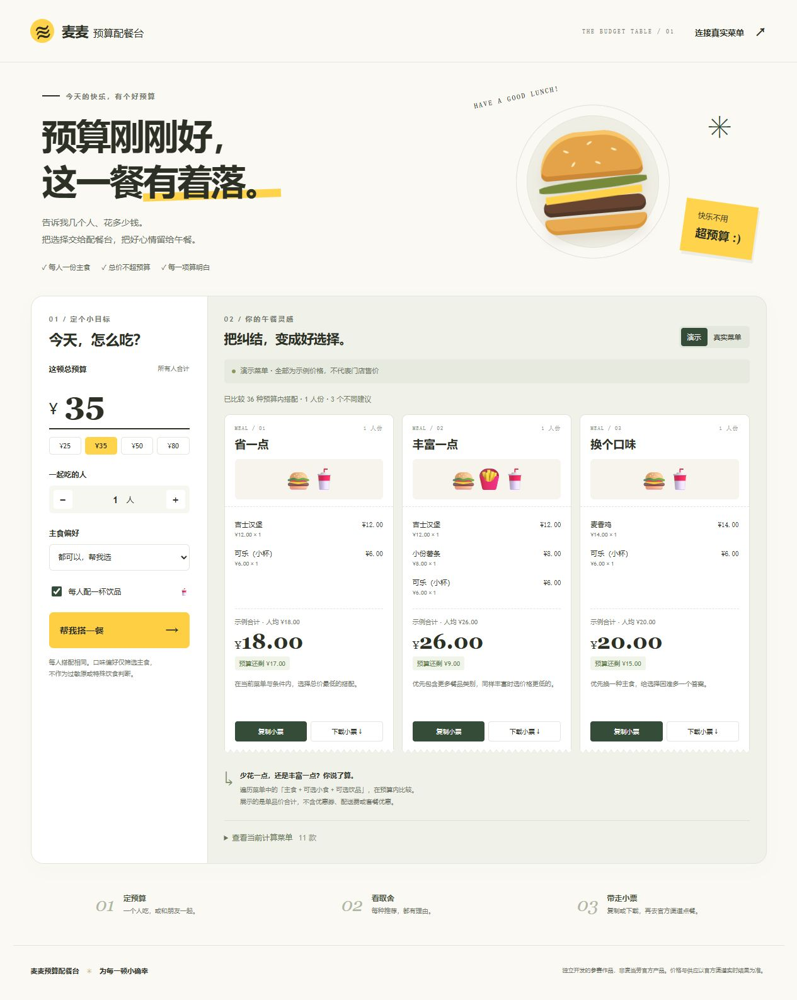

# 麦麦预算配餐台

项目仓库：[shuiqiuju/maimai-budget-table](https://github.com/shuiqiuju/maimai-budget-table)

**给预算一个好好吃饭的答案。** 输入总预算、人数和主食偏好，比较「省一点 / 丰富一点 / 换个口味」三种搭配，带走一张算得明白的点餐小票。

一个零 npm 依赖的本地 Web 应用和配套 Skill。面向预算有限、点餐选择困难的个人，以及想为 1–6 人快速比较同款搭配的小团队。



## 30 秒启动

需要 Node.js **22.6 或更高版本**，建议 Node.js 24 LTS。

```sh
npm start
```

打开终端显示的 `http://127.0.0.1:3210`。Windows 也可双击 `start.cmd`。无需 `npm install`，无需大模型 API，演示模式无需 Token 或网络。

## 你可以演示什么

1. 默认 ¥35 / 1 人，立即得到三张不同的小票。
2. 改成 ¥35 / 2 人，带饮品时诚实提示预算不足，而不拼凑不满足条件的结果。
3. 改成 ¥80 / 2 人，重新生成搭配；切换鸡肉、牛肉或鱼肉主食偏好。
4. 复制或下载小票。小票包含来源、人数、逐项单价、合计、余量和理由。
5. 接入真实门店后，以官方菜单参考价重算。

完整的 90 秒讲解顺序见 [DEMO.md](DEMO.md)。

## 连接真实麦当劳菜单

在 [麦当劳 MCP 开放平台](https://open.mcd.cn/mcp) 申请 Token。将 `.env.example` 复制为 `.env`，在本机填写以下两种方式之一：

```dotenv
MCD_MCP_TOKEN=你的真实Token
```

或者让项目读取仓库外的 UTF-8 纯文本文件，文件内容仅为 Token：

```dotenv
MCD_MCP_TOKEN_FILE=你的本机凭证文件绝对路径
```

两项都设置时，`MCD_MCP_TOKEN` 优先。修改后重启 `npm start`。不要将凭证放进网页、截图、README、Skill、Issue 或版本库。

网页右上角 **连接真实菜单** → 输入城市与公开地标 → 搜索门店 → 选择营业门店 → 核对筛选后的单品 → 使用这份菜单配餐。

- 默认填写“上海 / 人民广场”作为可更改的演示地点，不是用户实际位置。
- 当前快捷流程支持 **当时段到店自取**，不提供外送、得来速、预约或下单。
- API 使用原生 `fetch`，HTTPS 直连 `https://mcp.mcd.cn`，不使用 MCP 子进程或第三方代理。
- 官方接口失败时明确报错，不会自动把演示数据当成真实菜单。
- Token 与 MCP 会话留在本地服务；菜单仅保留内存，15 分钟后需刷新。
- 配置成功和完成真实查询是不同状态。必须实测真实读取后才能在参赛材料中声明接入成功。

## 为什么只用部分单品

官方菜单混合了单品、可选规格、套餐、随单购会员卡价格等。为避免漏算条件，本版本采取保守选择：

- 主食：官方汉堡分类里带“单品”标签、没有促销/随单购字段的具体餐品，排除“精选/随心/套餐”等组合。
- 小食：明确名称和份量的苹果片、心形薯饼 5 块。
- 饮品：盒装纯牛奶、盒装苹果汁、纯悦。
- 不把会员优惠、起价或需要选择规格的可乐/薯条组合当作确定单价。

这会少推荐一些餐品，但每个结果的计算范围可以追溯。当前按 `query-meals` 返回的 `currentPrice`（元）计算参考合计，**没有调用结算接口核价，不能保证为官方最终应付金额或全菜单最低价**。以官方点餐页实时价格及供应为准。

手动接入面板供开发者查看真实工具 schema 和映射其他菜单。只有明确为可独立购买、价格单位已确认的单品才能导入；口味与分类由操作者核对。

## 搭配算法

每人相同：1 份主食 + 0 或 1 份小食 + 0 或 1 份饮品。勾选饮品时每人必须有饮品。所有价格在计算前转为整数“分”，不使用浮点金额求和。

穷举当前菜单内的组合，保留 `每份价格 × 人数 ≤ 总预算` 的候选：

- **省一点**：总价最低。
- **丰富一点**：类别最多，同等类别下价格最低。
- **换个口味**：优先与前两项不同的主食，再按价格排序。

方案去重，最多 3 个；不足时按实际数量展示。无解时给出最低所需预算或缺失餐品类别。主食偏好不筛选小食，也不作过敏原判断。

## 项目结构

```text
public/                  页面、样式、交互，无构建步骤
lib/planner.mjs           预算约束与推荐
lib/mcp.mjs               原生 HTTP MCP 客户端与手动字段映射
lib/official-menu.mjs     已实测官方菜单结构适配
server.mjs               本机 HTTP 服务与只读接口
skills/maimai-budget/     智能体调用入口
test/                    算法、协议、服务及适配回归测试
MCP_INTEGRATION.md        实际工具、流程、价值及边界
CONTEST_DECLARATION.md    官方原版参赛声明
mcp-config.example.json  环境变量占位的 MCP 配置示例
```

## 验证

```sh
npm run check
```

测试使用内存中的模拟 HTTP 响应和临时本机端口，不读取真实 Token，也不请求官方服务。真实联调记录见 [docs/VERIFICATION.md](docs/VERIFICATION.md)。

## 参赛与发布

项目已准备官方要求的材料；发布与报名需要使用自己的 GitHub 个人账户。参赛 Issue 草稿见 [docs/SUBMISSION.md](docs/SUBMISSION.md)。未使用 WorkBuddy，不提供或伪造 `workbuddy.md`，不声明符合该专项奖励条件。

发布前排除 `.env`、`local/`、`artifacts/`、Token 文件和任何私人信息。仓库中的 `.gitignore` 已覆盖这些路径。公开发布前需再次核对最新版比赛规则与官方声明。

Windows 下可运行 `powershell -NoProfile -File scripts/package.ps1` 生成源码 ZIP。打包采用明确的文件白名单，输出到 `artifacts/maimai-budget-table-source.zip`，不包含本机凭证和联调原始数据。

本项目原创代码按 MIT License 开源。麦当劳名称和餐品商标属于权利人，官方声明及服务规则按其原有条款适用；本项目不提供品牌授权或官方背书。

独立开发的参赛作品，非麦当劳官方产品。输出不构成医疗、营养或其他专业建议。
